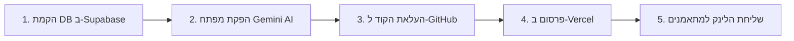

# מדריך פרסום והעלאה לאוויר (Deployment) – צעד אחר צעד (100% חינם)

מסמך זה ילווה אותך שלב אחר שלב מהמחשב המקומי ועד לאפליקציה חיה באוויר עם **מסד נתונים אמיתי בענן (Supabase)**, **מנוע AI פעיל (Gemini 2.5 Flash)**, וכתובת אינטרנט קבועה ב-**Vercel** שהמתאמנים שלך יוכלו להתקין על מסך הבית בטלפון.

> [!NOTE]
> הקוד של האפליקציה כבר חובר אוטומטית ל-Supabase דרך הקובץ [supabase.ts](file:///c:/Users/adit/Documents/Files/spot/spot-fitness/src/lib/supabase.ts). ברגע שתזין את מפתחות החיבור בשלב 4, כל מתאמן, טמפלייט וארוחה יישמרו ישירות במסד הנתונים האמיתי שלך בענן.

---

## תרשים זרימת ההקמה



---

## שלב 1: הקמת מסד נתונים חינמי אמיתי ב-Supabase (כ-3 דקות)

1. היכנס לאתר **[supabase.com](https://supabase.com)** ולחץ על **Start your project** (התחבר באמצעות חשבון ה-GitHub או ה-Google שלך – חינם וללא צורך בכרטיס אשראי).
2. לחץ על **New Project**:
   * **Name:** כתוב `spot-fitness`
   * **Database Password:** בחר סיסמה חזקה ושמור אותה בצד.
   * **Region:** בחר אזור קרוב לישראל (למשל `Frankfurt - eu-central-1`).
   * לחץ על **Create new project** והמתן כדקה עד שהמסד מוכן.
3. **יצירת הטבלאות בלחיצה אחת:**
   * בתפריט הצד השמאלי ב-Supabase, לחץ על **SQL Editor** ואז על **+ New query**.
   * פתח את הקובץ המוכן בפרויקט שלך: [schema.sql](file:///c:/Users/adit/Documents/Files/spot/spot-fitness/supabase/schema.sql).
   * העתק את כל התוכן של `schema.sql`, הדבק אותו בחלון ה-SQL Editor ב-Supabase, ולחץ על **Run** (בפינה הימנית התחתונה).
   * תופיע ההודעה: `Success. No rows returned` – הטבלאות `trainees` ו-`nutrition_templates` נוצרו!
4. **העתקת מפתחות החיבור:**
   * בתפריט הצד ב-Supabase, לחץ על **Project Settings** (אייקון גלגל השיניים למטה) ואז על **API** (או **Data API**).
   * שמור בצד את שני הערכים הבאים:
     1. **Project URL** (נראה כמו: `https://xxxxxx.supabase.co`)
     2. **Project API Keys -> `anon` `public`** (מחרוזת ארוכה שמתחילה ב-`eyJ...`)

---

## שלב 2: הפקת מפתח AI חינמי ל-Gemini 2.5 Flash (דקה אחת)

כדי שצילום הארוחות ופענוח הטקסט החופשי יעבדו מול מודל ה-AI של גוגל בחינם:

1. היכנס ל-**[Google AI Studio](https://aistudio.google.com/app/apikey)** עם חשבון הגוגל שלך.
2. לחץ על **Create API key**.
3. העתק את המפתח שנוצר (מתחיל ב-`AIzaSy...`) ושמור אותו בצד.

> [!TIP]
> התוכנית החינמית (Free Tier) של Google AI Studio למודל `gemini-2.5-flash` אינה עולה כסף ומאפשרת עד 1,500 בקשות ביום בחינם.

---

## שלב 3: העלאת הקוד שלך ל-GitHub (כ-2 דקות)

1. היכנס ל-**[github.com/new](https://github.com/new)** וצור Repository חדש בשם `spot-fitness` (אפשר לבחור **Private** כדי שהקוד יהיה פרטי שלך). אל תסמן "Add a README".
2. פתח את הטרמינל בתיקיית הפרויקט (`c:\Users\adit\Documents\Files\spot\spot-fitness`) והרץ את הפקודות הבאות לפי הסדר:

```powershell
git init
git add .
git commit -m "Initial commit - Spot Fitness Nutrition OS"
git branch -M main
git remote add origin https://github.com/<YOUR_GITHUB_USERNAME>/spot-fitness.git
git push -u origin main
```
*(החלף את `<YOUR_GITHUB_USERNAME>` בשם המשתמש שלך ב-GitHub).*

---

## שלב 4: העלאת האפליקציה לאוויר ב-Vercel (כ-2 דקות)

1. היכנס לאתר **[vercel.com](https://vercel.com)** ולחץ על **Sign Up / Log In** והתחבר באמצעות חשבון ה-**GitHub** שלך (תוכנית Hobby היא חינמית לתמיד).
2. במסך הראשי לחץ על **Add New...** -> **Project**.
3. תראה ברשימה את הפרויקט `spot-fitness` שהעלית ל-GitHub – לחץ לידו על **Import**.
4. **הגדרת משתני הסביבה (Environment Variables):**
   לפני שלוחצים על Deploy, פתח את הסעיף **Environment Variables** והוסף את 3 המשתנים הבאים מתוך מה ששמרת בשלבים 1 ו-2:

| שם המשתנה (Key) | הערך להדבקה (Value) |
| :--- | :--- |
| `NEXT_PUBLIC_SUPABASE_URL` | ה-**Project URL** שהעתקת מ-Supabase |
| `NEXT_PUBLIC_SUPABASE_ANON_KEY` | מפתח ה-**anon public** שהעתקת מ-Supabase |
| `GEMINI_API_KEY` | מפתח ה-**Gemini API** שהעתקת מ-Google AI Studio |

5. לחץ על **Deploy**.
6. תוך כדקה תקבל מסך חגיגי עם הקישור הקבוע של האפליקציה שלך (למשל: `https://spot-fitness.vercel.app`)!

---

## שלב 5: בדיקה מקומית במחשב שלך עם ה-DB האמיתי (אופציונלי)

אם תרצה שגם כשאתה מריץ במחשב שלך (`http://localhost:3000`) המערכת תעבוד מול ה-Supabase האמיתי ו-Gemini:

1. צור קובץ בשם `.env.local` בתיקיית השורש של הפרויקט (`c:\Users\adit\Documents\Files\spot\spot-fitness\.env.local`).
2. הדבק בו את 3 השורות הבאות עם המפתחות שלך:

```env
NEXT_PUBLIC_SUPABASE_URL=https://your-project-id.supabase.co
NEXT_PUBLIC_SUPABASE_ANON_KEY=eyJhbGciOiJIUzI1NiIsInR5cCI6...
GEMINI_API_KEY=AIzaSy...
```

3. הפעל מחדש את `npm run dev`.

---

## שלב 6: איך המתאמנים מתקינים את האפליקציה על הטלפון (PWA)

האפליקציה כבר מוגדרת כ-**PWA** מלאה ([manifest.json](file:///c:/Users/adit/Documents/Files/spot/spot-fitness/public/manifest.json)). כשאתה שולח למתאמנים את הלינק מ-Vercel בוואטסאפ, שלח להם את ההנחיה הקצרה הזו:

* **באייפון (Safari):**
  1. פותחים את הקישור ב-Safari.
  2. לוחצים על כפתור ה**שיתוף** (ריבוע עם חץ למעלה בתחתית המסך).
  3. בוחרים **"הוסף למסך הבית" (Add to Home Screen)**.
* **באנדרואיד (Chrome):**
  1. פותחים את הקישור ב-Chrome.
  2. לוחצים על תפריט 3 הנקודות למעלה.
  3. בוחרים **"התקן אפליקציה" (Install App)** או **"הוסף למסך הבית"**.

האפליקציה תופיע אצלם על מסך הבית עם אייקון עצמאי ותיפתח על מסך מלא ללא שורת כתובת של דפדפן, בדיוק כמו אפליקציה מחנות האפליקציות!
