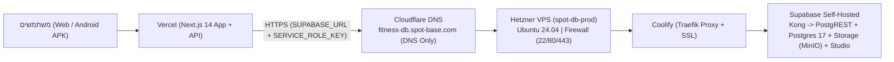

# מדריך תשתית ותחזוקה — המעבר מ-Supabase Cloud ל-Hetzner + Coolify

> [!CAUTION]
> **בטיחות מידע:** קובץ זה שמור ב-Git של הפרויקט ולכן **אינו מכיל סיסמאות או מפתחות סודיים** (`SERVICE_ROLE_KEY`, `POSTGRES_PASSWORD`, סיסמת Studio וכו'). כל הערכים הסודיים נשמרים בצורה מאובטחת בתוך ממשק **Coolify** (תחת `General` / `Environment Variables`) ובתוך **Vercel** (תחת `Settings -> Environment Variables`).

מסמך זה מתעד בצורה מרוכזת את כל מה שהוקם, הוגדר והשתנה במעבר של **Spot Fitness** לשרת Postgres עצמאי ב-Hetzner, כולל הוראות התחברות ופקודות תחזוקה לעתיד.

---

## 1. סקירת הארכיטקטורה הנוכחית



- **Vercel:** ממשיך לארח את אפליקציית ה-Next.js ונקודות הקצה (`/api/*`), ומתחבר לשרת ה-DB החדש בדומיין `https://fitness-db.spot-base.com`.
- **Hetzner Cloud:** מריץ את **Coolify `v4.7.9`** ובתוכו את סטאק **Supabase Self-Hosted** (כולל `Postgres 17.6` עם `pgvector` ו-`pg_trgm`, `PostgREST`, `Kong`, `Storage` + `MinIO` עבור קובצי APK, ו-`Studio`).
- **Cloudflare DNS:**
  - הרשומה הראשית של האפליקציה נשארת מופנית ל-Vercel.
  - נוצרה רשומת **`A`** לתת-דומיין **`fitness-db.spot-base.com`** -> כתובת IPv4 ציבורית **`2.31.147.156`**.
  - מצב Proxy: **`DNS only`** (ענן אפור כבוי) כדי ש-Traefik ב-Coolify יחדש תעודות SSL (Let's Encrypt) ללא הפרעה.

---

## 2. פרטי השרת והרשת ב-Hetzner Cloud

- **פרויקט ב-Hetzner:** `spot-fitness`
- **שם השרת:** `spot-db-prod`
- **דגם:** `CX23` (`2 vCPU`, `4 GB RAM`, `40 GB NVMe`, `20 TB` תנועה יוצאת)
- **אזור (Location):** גרמניה (`Falkenstein` / `Nuremberg`)
- **מערכת הפעלה:** `Ubuntu 24.04.5 LTS`
- **כתובות IP:**
  - IPv4 ציבורי: `2.31.147.156`
  - IPv6 ציבורי: `2a01:4f8:1c19:faba::1`
- **זיכרון Swap שהוגדר בשרת:** `4.0 GiB` בקובץ `/swapfile` (רשום קבוע ב-`/etc/fstab` כהגנה מפני קריסות OOM).
- **גיבויים אוטומטיים:** מופעלים ברמת Hetzner (בתוספת 20% לעלות השרת, שומרים גיבויים יומיים מתגלגלים ל-7 ימים).
- **חומת אש (`spot-fw`):**
  - **Inbound:** פתוחים **רק** `TCP 22` (SSH), `TCP 80` (HTTP ל-Let's Encrypt והפניה ל-HTTPS), `TCP 443` (HTTPS).
  - **סגורים לאינטרנט:** פורט `8000` (ממשק Coolify) ופורט `5432` (PostgreSQL). הגישה אליהם מתבצעת רק מתוך ה-SSH או דרך מנהרת SSH מאובטחת.

---

## 3. איך מתחברים לניהול ותחזוקה?

### א. התחברות ב-SSH לשרת (Windows PowerShell)
מפתח ה-SSH הציבורי הוגדר ב-Hetzner תחת השם **`windows-main`** (המפתח הפרטי שמור במחשב בנתיב `%USERPROFILE%\.ssh\id_ed25519`).

```powershell
ssh -i "$env:USERPROFILE\.ssh\id_ed25519" root@2.31.147.156
```

### ב. כניסה לממשק Coolify (דרך SSH Tunnel — ללא פתיחת פורט 8000)
1. פתח חלון **PowerShell** במחשב והרץ (החלון נשאר ריק/שקט כל עוד המנהרה פתוחה — זה תקין):
   ```powershell
   ssh -N -L 8000:127.0.0.1:8000 -i "$env:USERPROFILE\.ssh\id_ed25519" root@2.31.147.156
   ```
2. פתח בדפדפן במחשב: **`http://localhost:8000`**
3. התחבר עם חשבון המנהל של Coolify.
4. ניווט לשירות: **`Projects` -> `spot-fitness` -> `production` -> `supabase-jfwl29eyeub8bbnui5xcknrb`**.
5. כשתסיים לעבוד — לחץ `Ctrl + C` בחלון ה-PowerShell כדי לסגור את המנהרה.

### ג. כניסה לממשק Supabase Studio (SQL Editor, טבלאות, Storage)
- **כתובת:** **`https://fitness-db.spot-base.com`**
- **שם משתמש וסיסמה (Basic Auth של Kong):**
  נמצאים בתוך Coolify תחת:
  - `General -> Service configuration -> Admin User / Admin Password`
  - או ב-`Environment Variables` תחת **`SERVICE_USER_ADMIN`** ו-**`SERVICE_PASSWORD_ADMIN`**.

### ד. חיבור ישיר למסד הנתונים ב-SSH (לשאילתות ובדיקות)
שם קונטיינר ה-Database ב-Docker הוא **`supabase-db-jfwl29eyeub8bbnui5xcknrb`** (מריץ `supabase/postgres:17.6.1.136`).

```bash
# בדיקת תקינות כל הקונטיינרים
docker ps --format "table {{.Names}}\t{{.Status}}"

# בדיקת RAM, Swap ונפח דיסק פנוי
free -h && df -h /

# כניסה למסוף SQL ישירות בתוך Postgres
docker exec -it supabase-db-jfwl29eyeub8bbnui5xcknrb psql -U postgres -d postgres
```

---

## 4. שמות המשתנים ואיפה כל הגדרה נשמרת

### א. הגדרות שבוצעו ב-Coolify
- **`Domains` (בכרטיסיית `Supabase Kong`):**
  - דומיין: **`https://fitness-db.spot-base.com`**
  - פורט פנימי: **`8000`**
  - `Redirect HTTP to HTTPS`: **`Enabled`**
  - `Certificate resolver`: **`Server setting (letsencrypt)`**
  - *(ל-`Imgproxy` הוסר הדומיין הציבורי — אין צורך בחשיפה חיצונית שלו).*
- **`General -> Service configuration`:**
  - `PostgreSQL Database Name`: נשאר ריק / ברירת מחדל (`postgres`).
  - `Admin User` / `Admin Password`: פרטי הכניסה ל-Studio.
  - `MinIO Admin User` / `MinIO Admin Password`: גישת אחסון הקבצים הפנימית (`Storage`).
- **`Environment Variables` שהוגדרו/נבדקו ידנית ב-Coolify:**
  - **`PGRST_DB_EXTRA_SEARCH_PATH`** = `public,extensions` *(חיוני לזיהוי `pgvector` ו-`pg_trgm`)*
  - **`PGRST_DB_MAX_ROWS`** = `1000`
  - **`API_EXTERNAL_URL`** = `https://fitness-db.spot-base.com` *(או `${SERVICE_URL_SUPABASEKONG}`)*
- **מפתחות ה-API שנוצרו אוטומטית ב-Coolify (לשימוש בצד Vercel בלבד):**
  - **`SERVICE_SUPABASESERVICE_KEY`** — מפתח `service_role` (גישת שרת מלאה עוקפת RLS + הרשאות Storage).
  - **`SERVICE_SUPABASEANON_KEY`** — מפתח `anon`.

### ב. הגדרות ב-Vercel (`Settings -> Environment Variables`)
| שם המשתנה ב-Vercel | מקור הערך | הערות חשובות |
| :--- | :--- | :--- |
| `SUPABASE_URL` | `https://fitness-db.spot-base.com` | **ללא** `/rest/v1` או `/` בסוף |
| `SUPABASE_SERVICE_ROLE_KEY` | מתוך `SERVICE_SUPABASESERVICE_KEY` ב-Coolify | חיוני ב-Production (עוקף RLS ומאפשר ניהול ה-Bucket של ה-APK) |
| `SUPABASE_ANON_KEY` *(אם מוגדר)* | מתוך `SERVICE_SUPABASEANON_KEY` ב-Coolify | אופציונלי — בקוד `SUPABASE_SERVICE_ROLE_KEY` מקבל עדיפות ראשונה |
| `NEXT_PUBLIC_SUPABASE_URL` / `NEXT_PUBLIC_SUPABASE_ANON_KEY` *(רק אם קיימים ב-Vercel)* | הדומיין ומפתח ה-`ANON` מ-Coolify | לעדכן כדי שלא יישארו ערכי Supabase הישן |

> [!IMPORTANT]
> בכל פעם שמעדכנים משתנה סביבה ב-Vercel, חובה להיכנס ללשונית **`Deployments` -> `...` -> `Redeploy`** ולהוריד את הסימון מ-**`Use existing Build Cache`**.

---

## 5. מבנה מסד הנתונים, מיגרציות ו-Storage

### א. סדר הרצת המיגרציות (כבר הורצו בהצלחה)
במקרה של הקמה מחדש בעתיד, יש להריץ ב-**SQL Editor** בדיוק לפי הסדר הזה:
1. [supabase/schema.sql](file:///c:/Users/adit/Documents/Files/spot/spot-fitness/supabase/schema.sql)
2. [supabase/migrations/20261125_food_search_and_history.sql](file:///c:/Users/adit/Documents/Files/spot/spot-fitness/supabase/migrations/20261125_food_search_and_history.sql)
3. [supabase/migrations/20261126_semantic_food_search.sql](file:///c:/Users/adit/Documents/Files/spot/spot-fitness/supabase/migrations/20261126_semantic_food_search.sql) *(חובה אחרי מס' 2 — מפעיל `pgvector` עם `halfvec(768)` ומעדכן את `search_food_catalog_hybrid`)*
4. [supabase/migrations/20261125_telemetry.sql](file:///c:/Users/adit/Documents/Files/spot/spot-fitness/supabase/migrations/20261125_telemetry.sql)
5. [supabase/migrations/20261125_ai_monitoring_rpc.sql](file:///c:/Users/adit/Documents/Files/spot/spot-fitness/supabase/migrations/20261125_ai_monitoring_rpc.sql)
6. [supabase/migrations/20261126_ai_conversation_traces.sql](file:///c:/Users/adit/Documents/Files/spot/spot-fitness/supabase/migrations/20261126_ai_conversation_traces.sql)
7. [supabase/migrations/20261126_role_rate_limits.sql](file:///c:/Users/adit/Documents/Files/spot/spot-fitness/supabase/migrations/20261126_role_rate_limits.sql)

בנוסף הורצה ב-SQL Editor הגדלת Timeout ל-PostgREST:
```sql
ALTER ROLE authenticator SET statement_timeout = '30s';
NOTIFY pgrst, 'reload config';
```

### ב. אחסון קבצים (`Storage`)
- **Bucket עבור גרסאות אנדרואיד:** **`app-releases`** (מוגדר כ-`Public bucket`).
- ניהול והעלאה מתוך ממשק הניהול של Spot דרך [src/app/api/admin/apk-release/route.ts](file:///c:/Users/adit/Documents/Files/spot/spot-fitness/src/app/api/admin/apk-release/route.ts).

---

## 6. תיעוד העברת הנתונים ושינויי הקוד שבוצעו

### א. העברת הנתונים מ-Supabase Cloud ל-Hetzner
- הייצוא בוצע מתוך השרת דרך **Session pooler** (פורט `5432` מעל IPv4, מכיוון שחיבור Direct של Supabase הוא IPv6-only ו-Transaction Pooler ב-`6543` שובר `pg_dump`), בפורמט בינארי (`-F c --data-only --disable-triggers -n public`) כדי לשמור במלואם את עמודות `GENERATED ALWAYS AS IDENTITY` ואת עמודות הווקטורים (`halfvec`).
- גודל קובץ ה-Dump שהועבר: `49.1 MB`.
- אומתו שלמות כל השורות לאחר השחזור, כולל:
  - `coaches`: `1`
  - `trainees`: `4`
  - `trainee_groups`: `4`
  - `nutrition_templates`: `9`
  - `food_catalog_items`: `12,419`
  - `food_with_embedding`: `12,419` (כל הווקטורים עברו תקינים)
  - `user_food_history`: `50`
  - `search_query_embeddings`: `108`
  - `ai_trace_conversations`: `12` (`ai_trace_media`: `16`)
  - `api_request_logs`: `3,402`
  - `audit_activity_events`: `718`
- הערה: בשחזור עם `postgres` מופיעות אזהרות הרשאה על `RI_ConstraintTrigger` (טריגרי מערכת של FK בטבלאות `ai_trace_*`) וכן דילוג `ANALYZE` על טבלאות מערכת פנימיות — זה תקין; סדר הטבלאות שוחזר תקין והנתונים נטענו במלואם.

### ב. שינויים שבוצעו בקוד לפני המעבר (קומיט `71e365d`)
נפתרה תקלה שבה כשל/Timeout מול DB החזיר `403 AUTH_OR_PERMISSION` ("אין הרשאה לסנכרן משימת AI למתאמן זה") ובנוסף הוקטנה תעבורת `SELECT *` בבקשות ה-AI:
- [src/lib/traineeAccess.ts](file:///c:/Users/adit/Documents/Files/spot/spot-fitness/src/lib/traineeAccess.ts) — אימות זהות ישיר למתאמן (ללא `SELECT *`) והבחנה בין `403` לחוסר הרשאה לבין `503 AUTH_DB_UNAVAILABLE` בכשל DB.
- [src/lib/supabase.ts](file:///c:/Users/adit/Documents/Files/spot/spot-fitness/src/lib/supabase.ts) — נוספו `loadTraineeAccessStateFromSupabase`, `loadTraineePendingAiJobsFromSupabase`, ו-`loadSingleTraineeOutcomeFromSupabase`.
- [src/lib/serverStore.ts](file:///c:/Users/adit/Documents/Files/spot/spot-fitness/src/lib/serverStore.ts) — נוספו `authorizeTraineeAiTargetOnServer` ו-`getTraineePendingAiJobsOnServer`.
- [src/app/api/ai/analyze-meal/route.ts](file:///c:/Users/adit/Documents/Files/spot/spot-fitness/src/app/api/ai/analyze-meal/route.ts) ו-[src/lib/telemetry/aiTelemetry.ts](file:///c:/Users/adit/Documents/Files/spot/spot-fitness/src/lib/telemetry/aiTelemetry.ts) — שימוש בבדיקות קלות משקל וסיווג שגיאות DB בבירור בניטור.

---

## 7. פקודות שימושיות לגיבוי ושחזור מהיר בעתיד

### יצירת גיבוי ידני של כל הטבלאות והווקטורים והורדתו למחשב Windows
1. ב-SSH של Hetzner:
   ```bash
   docker exec -i supabase-db-jfwl29eyeub8bbnui5xcknrb \
     pg_dump -U postgres -d postgres -n public -F c -f /tmp/spot_backup.dump
   docker cp supabase-db-jfwl29eyeub8bbnui5xcknrb:/tmp/spot_backup.dump /root/spot_backup.dump
   docker exec -i supabase-db-jfwl29eyeub8bbnui5xcknrb rm -f /tmp/spot_backup.dump
   ```
2. בחלון **PowerShell** במחשב Windows להורדת הקובץ מהשרת למחשב:
   ```powershell
   scp -i "$env:USERPROFILE\.ssh\id_ed25519" root@2.31.147.156:/root/spot_backup.dump .\spot_backup.dump
   ```

### צפייה בלוגים חיים במקרה של תקלה
- דרך Coolify UI (`http://localhost:8000`) -> לשונית **`Runtime Logs`**.
- או דרך SSH:
  ```bash
  docker logs --tail 100 supabase-rest-jfwl29eyeub8bbnui5xcknrb
  docker logs --tail 100 supabase-kong-jfwl29eyeub8bbnui5xcknrb
  docker logs --tail 100 supabase-db-jfwl29eyeub8bbnui5xcknrb
  ```
